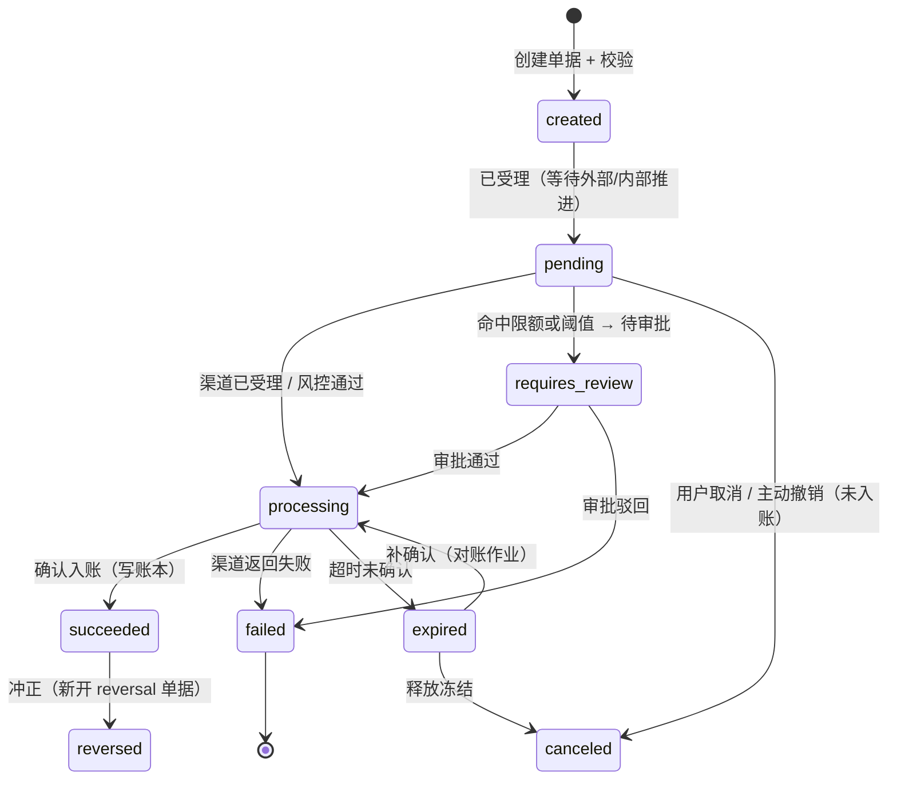
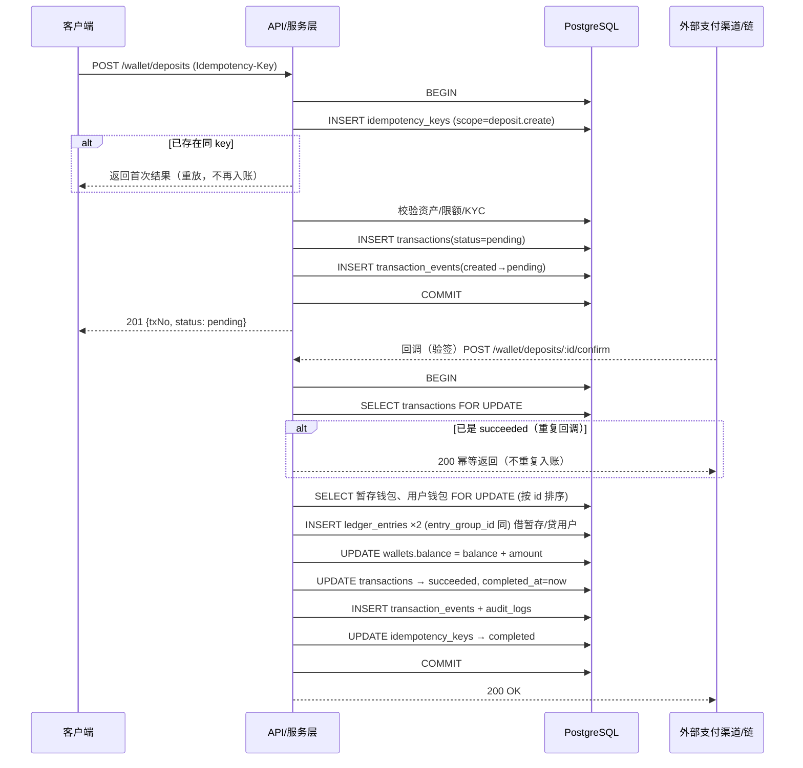
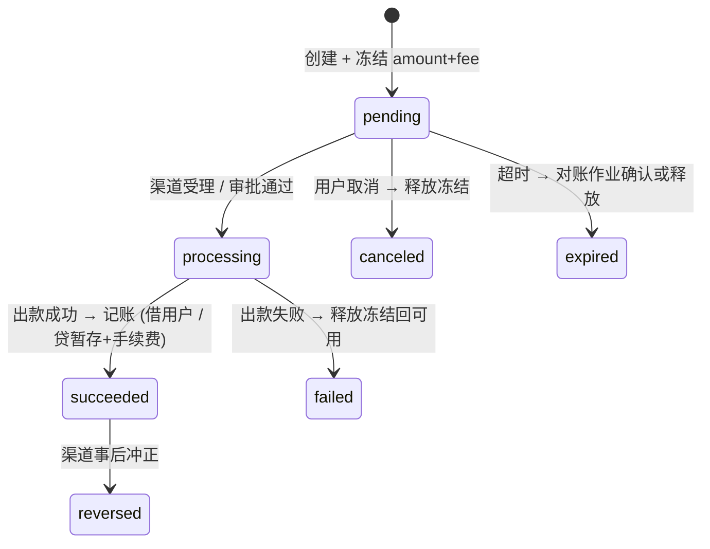
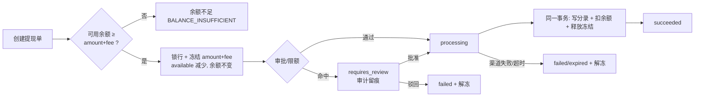
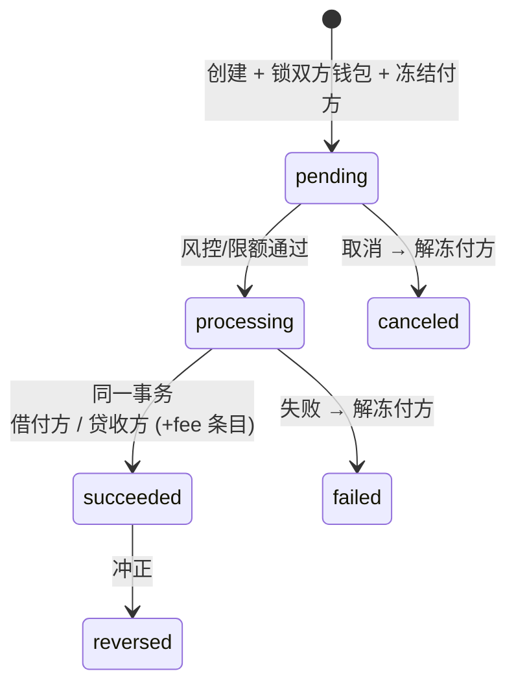
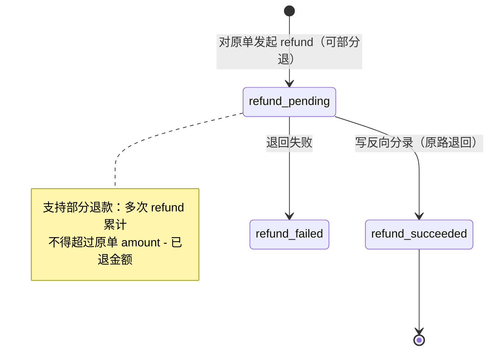
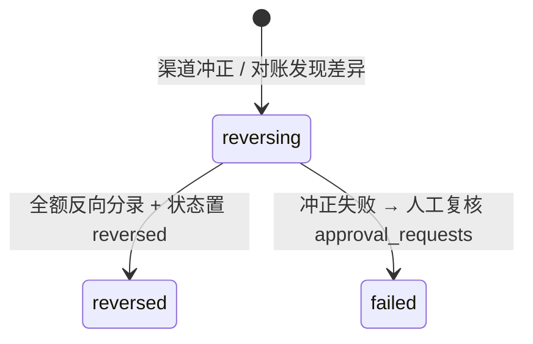

# 03 · 状态流转图（充值 / 提现 / 转账 / 退款）

## 3.1 统一交易状态机

约束：
- `succeeded` 是**终态**，只能由新的 `reversal/refund` 单据反向，不允许改历史。
- `failed / canceled / expired(转 canceled)` **不写账本分录**，只释放 `holds`。
- 每次状态变更都会插入一行 `transaction_events`。

---

## 3.2 充值（deposit）

充值：**不冻结**（不涉及用户出账），到账即入账。
失败回调：`pending → failed`，不写分录。

---

## 3.3 提现（withdrawal）

---

## 3.4 转账（transfer）

关键点：
- **行锁顺序**：按 `wallet.id` 升序 `FOR UPDATE`，避免并发死锁。
- 付方与收方**必须同币种**（跨币种需走外汇模块，当前不支持，返回 `CROSS_ASSET_UNSUPPORTED`）。
- 自转账（付方=收方）直接拒绝。
- 并发保护：行锁 + `CHECK(balance>=0)` 双保险，任何情况下不会出现负余额或重复扣款。

---

## 3.5 退款 / 冲正

- 退款/冲正都是**新单据**（`parent_transaction_id` 指向原单），原单不可改。
- 反向分录复用原单的 `entry_group_id` 语义（新建 group，`entry_type = refund/reversal`）。
- 已退款金额在 `parent` 上通过 `SUM(ledger amount)` 或 `transactions.metadata.refunded` 累计校验。

---

## 3.6 处理失败/超时的通用规则

| 场景 | 处理 |
| --- | --- |
| 请求超时（客户端没拿到响应） | 客户端带同一 `Idempotency-Key` 重试 → 返回首次结果 |
| 渠道重复回调 | 同 `provider+provider_ref` 且已 `succeeded` → 200 幂等，不重复入账 |
| 内部异常 | 整个事务回滚，`failure_code/failure_reason` 落库，告警 |
| 部分成功 | 拆分子单，每张子单独立状态；父单只在子单全部终态后结算 |
| 渠道超时未决 | 单据进入 `expired`，对账作业按渠道流水补确认或释放冻结 |
